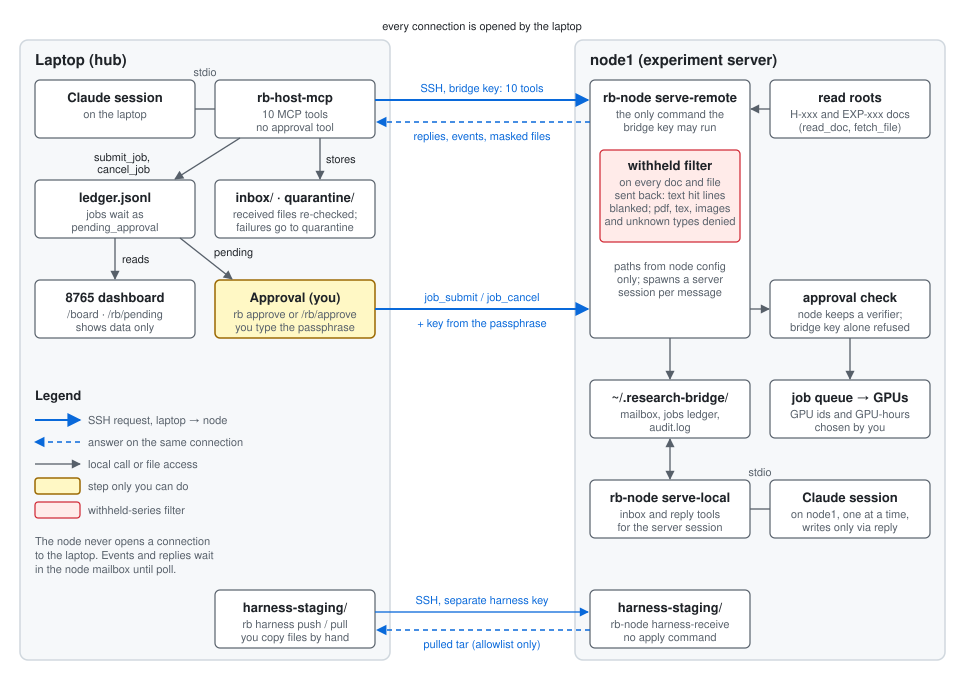
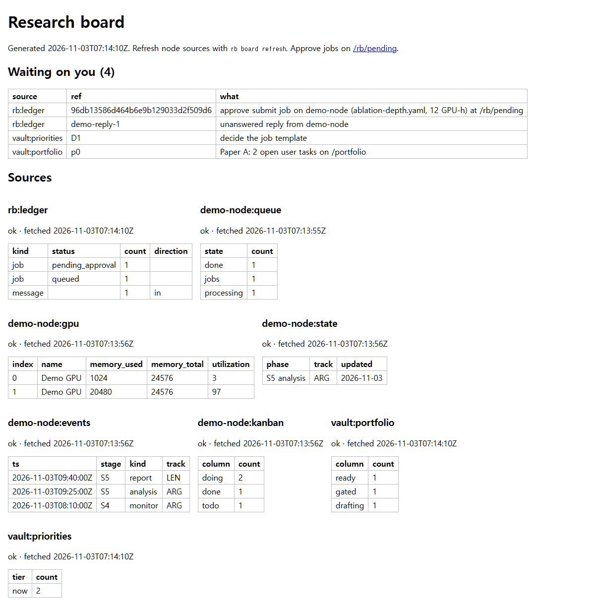
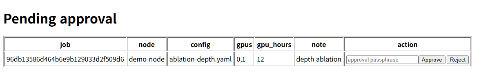

> 영어판 [README.md](README.md)가 기준 문서이다. 이 파일은 2026-11-10에 번역했다.

# research-bridge

research-bridge는 **허브(hub)**의 Claude 세션과 실험 서버인 **노드(node)**의 Claude 세션을 SSH (Secure Shell)로 연결한다. 허브는 키와 데이터를 가진 기계이며, 여기서는 Linux 서버이다. 허브의 세션은 노드의 세션에 첨부 파일이 달린 메시지를 보내고, 노드의 가설(H-xxx) 문서와 실험(EXP-xxx) 문서를 보류 자료를 가린 채 읽고, 작업 대기열과 GPU (graphics processing unit) 사용 현황을 보고, 작업 실행을 요청할 수 있다. 허브 쪽은 MCP (Model Context Protocol) 서버 `rb-host-mcp`와 명령줄 도구 `rb`이다. 노드 쪽 `rb-node`는 표준 라이브러리만 쓰는 Python이며, 허브가 SSH로 접속해 사용한다.



- **연결은 허브만 연다.** 노드는 같은 연결로 응답하며, 허브에 직접 접속하지 않는다.
- **세션은 작업을 요청할 수 있지만 승인할 수는 없다.** 사용자가 허브 터미널에서 `rb approve`를 실행하고 승인 암호문(passphrase)을 입력해 승인한다. 노드는 그 암호문에서 만든 키를 자신이 저장한 검증값(verifier)과 대조한다.
- **보류 자료는 노드에서 걸러내고, 저장하거나 보여 주기 전에 허브에서 다시 검사한다.**

## 요구 사항

| | 허브 | 노드 |
|---|---|---|
| 시스템 | Linux. 선택 사항인 타이머와 페이지에는 systemd 사용자 관리자가 필요하다 | Linux (설치 스크립트가 GNU `mv -T`를 쓴다) |
| Python | uv가 설치한다 (3.10 이상) | `PATH`에 `python3` 3.8 이상 |
| 프로그램 | [uv](https://docs.astral.sh/uv/), git, OpenSSH 클라이언트(`ssh`, `ssh-keygen`, `ssh-agent`, `ssh-add`, `ssh-keyscan`), Claude 명령줄 인터페이스(CLI, `claude`; MCP 서버를 등록하는 데 쓴다), `ip`(선택 사항; 허브 주소를 찾는 데 쓴다) | git, OpenSSH 서버. 선택 사항: `pdftotext`(없으면 pdf 파일은 거부된다), Claude CLI(살아 있는 세션이 없을 때 메시지에 응답하는 응답기) |
| 접근 | 질문을 던지는 명령을 실행할 터미널 | 노드 사용자로 하는 콘솔 로그인 |

## 노드 없이 써 보기

터미널에서, 이 저장소의 클론 안에서 실행한다.

```
uv sync --extra host
uv run --extra host python scripts/demo_dashboard.py
```

데모는 같은 기계에서 임시 노드 프로세스(SSH 없음)를 시작한다. 가짜 작업, 가짜 GPU, 저장된 대화 하나가 새 임시 디렉터리에 만들어진다. 출력은 다음과 같다.

```
demo data: /tmp/rb-demo-...
open http://127.0.0.1:8799/board and /rb/pending (passphrase: demo passphrase)
hub page: http://127.0.0.1:8800/ (also /threads, /jobs, /nodes)
```

`/board`와 `/rb/pending`은 노트북의 8765 대시보드 페이지를 복사한 것이다. `/rb/pending`에서 대기 중인 작업 두 개 중 하나를 암호문 `demo passphrase`로 승인하면 데모 노드에 대해 실제 승인 경로가 실행되고, 이어서 `/board`에 대기열에 들어간 작업이 나타난다. 8800 포트는 [매일 쓰기](#매일-쓰기)에서 설명하는 허브 페이지를 제공한다. 데모 노드에는 패턴 파일이 없으므로 배너가 표시된다. 데모는 Ctrl+C로 멈춘다. 데모는 자신의 데이터 디렉터리(`/tmp/rb-demo-...`)를 지우지 않으므로 직접 지우거나 `--dir DIR`로 위치를 정한다. 위의 세 줄은 터미널에서만 바로 나타나며, 출력을 리디렉션하면 버퍼링으로 늦어질 수 있다. 브라우저가 없는 허브에서 데모를 실행하면 노트북에서 두 포트를 모두 포워딩한다: `ssh -N -L 8799:127.0.0.1:8799 -L 8800:127.0.0.1:8800 <HUB_HOST>`.

| 통합 보드 (`/board`) | 승인 대기 (`/rb/pending`) |
|---|---|
|  |  |

## 노드 연결하기

**`rb` 실행 방법.** 허브 터미널의 체크아웃 디렉터리 안에서는 아래의 모든 `rb` 명령을 `uv run --extra host rb ...`로 입력한다. 어느 디렉터리에서든 `rb`만 입력하려면, 체크아웃 경로를 넣어 다음 줄을 셸 프로필에 추가한다.

```
alias rb='uv run --directory ~/research-bridge --extra host rb'
```

`~/research-bridge`는 1단계에서 clone한 디렉터리로 바꾼다. 노드 쪽의 `rb-node`는 노드에서 `scripts/node-install.sh`를 실제로 실행한 뒤에야 존재하며, `--dry-run`은 아무것도 설치하지 않는다.

**누가 무엇을 입력하는가.** `rb setup`, `rb agent`, `rb service install`, `rb approve`, `rb reject`, `rb-node approve-key set`, `authorized_keys` 변경은 stdin과 stdout이 터미널이 아니면 실행을 거부하므로 Claude 세션이 실행할 수 없고, 사용자가 직접 입력한다. 세션이 실행할 수 있는 것은 `rb setup --node node1 --yes-print-only`(모든 변경과 명령을 보여 주고, 아무것도 쓰거나 묻지 않는다; 처음 실행할 때는 `--host`와 `--user`도 필요하다), `rb doctor --offline`(허브만 점검하며 연결하지 않는다), `rb pending`, `rb service status`이다. `--offline` 없는 `rb doctor`와 `rb sync`는 노드에 연결하므로 사용자의 승인이 필요하다. 이 기계의 Claude 세션은 셸 명령 앞에 `rtk`를 붙인다. `rb`에는 `rtk proxy uv run --extra host rb doctor`를 쓴다. 일반 `rtk`는 `next:` 줄을 숨기기 때문이다. 노드에 접속하는 명령은 모두 사용자의 허락을 받은 뒤에 실행한다.

**저장소 밖의 파일.** 허브에서 `rb setup`은 `~/.ssh/research-bridge/`에 키 쌍 두 개(`node1_ed25519`, `node1_harness_ed25519`)를 만들고, `~/.ssh/config`에 `Host` 블록 두 개를, `~/.ssh/known_hosts`에 호스트 키 줄을 추가한다. `rb service install`은 `~/.config/systemd/user/`에 unit 파일 세 개를 쓴다. 이 수정은 모두 먼저 보여 주고, 사용자가 `y`를 입력한 뒤에만 수행하며, 기존 파일은 먼저 `<name>.bak.<timestamp>`로 복사한다. 데이터 루트와 `host.json`은 묻지 않고 만든다. `rb`는 `~/.claude.json`을 수정하지 않는다. `rb`가 출력하는 `claude mcp add-json` 명령은 사용자가 실행한다. 노드에서 `scripts/node-install.sh`는 자신의 파일을 묻지 않고 쓴다(`~/.local/share/research-bridge/` 아래의 코드, 래퍼 `~/.local/bin/rb-node`, `node.json`·메일함·설치 기록이 있는 `~/.research-bridge/`). `~/.ssh/authorized_keys`는 `--apply-authorized-keys`를 줄 때만, 터미널에서, 변경 내용을 보여 주고 `y` 응답을 받은 뒤, 백업을 먼저 만들고 수정한다.

1. **허브 터미널: 설치.** git worktree가 아니라 메인 체크아웃을 쓴다. MCP 항목과 unit 파일에 이 경로가 기록되기 때문이다. 위의 `alias rb=...` 줄은 이 디렉터리를 가리켜야 한다.
   ```
   git clone <REPO_URL> research-bridge && cd research-bridge
   uv sync --extra host
   ```
2. **허브 터미널: 허브 패턴 파일.** 데이터 루트는 `$RB_HOST_ROOT`가 설정돼 있으면 그 값이고, 아니면 `~/.local/share/research-bridge`이다. 없으면 `rb setup`이 직접 만들지만 이 단계에는 지금 필요하다. 보류 패턴 파일을 `withheld_patterns.json`이라는 이름으로 그 안에 둔다. 이 파일이 없으면 `rb doctor`가 fail을 보고하고, `rb setup`은 패턴 파일 없는 노드 명령을 출력한다. 파일은 JSON (JavaScript Object Notation)이며 모양은 아래와 같고, 각 패턴은 Python 정규식이다(실제 파일은 노트북의 vault에 보관된 session-calendar 내보내기이다).
   ```
   {"families": [{"patterns": ["PATTERN-1", "PATTERN-2"]}]}
   ```
   허브에서 디렉터리를 만든다.
   ```
   mkdir -p -m 700 "${RB_HOST_ROOT:-$HOME/.local/share/research-bridge}"
   ```
   그다음 노트북 터미널에서 파일을 복사한다(기본 데이터 루트 기준이며, `RB_HOST_ROOT`가 설정돼 있으면 `.local/share/research-bridge` 대신 그 디렉터리를 쓴다).
   ```
   scp <path-on-laptop>/withheld_patterns.json <HUB_HOST>:.local/share/research-bridge/withheld_patterns.json
   ```
   `families`가 비어 있거나 `patterns`가 없는 family만 있는 파일은 패턴이 없는 것으로 간주되어 `rb doctor`가 계속 fail한다. vault도 보류 자료도 없다면 자리표시자 패턴 하나로 검사를 통과할 수 있다. 예: `{"families": [{"patterns": ["NO-WITHHELD-SERIES-PLACEHOLDER"]}]}`. 이는 기본 내장 패턴 다섯 개 이상의 보호를 주지 않으므로, `read_doc`, `send_message`, `poll`이 필요한지는 직접 판단한다.
3. **허브 터미널: 네 가지 정보로 `rb setup` 실행** (노드 이름, 호스트, SSH 포트, 사용자). 선택 사항: `--research-root DIR`(노드의 연구 트리. 노드 명령에 복사된다), `--hub-from ADDR`(노드가 이 허브를 보는 주소. 없으면 `ip route get`으로 구한다), `--keydir DIR`.
   ```
   rb setup --node node1 --host <NODE_HOST> --port <NODE_PORT> --user <NODE_USER>
   ```
   `rb setup`은 두 번 실행한다. 첫 실행이 이것이고, 7단계에서 `rb setup --node node1`로 다시 실행한다(정보가 이미 `host.json`에 있으므로 플래그를 반복하지 않는다). 아홉 부분은 번호가 붙은 README 단계와 구별하려고 여기서 스테이지라 부르며, 프로그램은 `step N/9 ...`로 출력한다. 각 스테이지는 `-> done`, `skipped`, `printed`, `failed: ...` 중 하나로 끝난다. (1) 데이터 루트와 `host.json`. (2) 별칭 `rb-node1`과 `rb-node1-harness`를 가진 노드 항목. (3) 키: `Generate ...? [y/N]`을 묻고, 이어서 `ssh-keygen`이 키마다 암호문을 두 번 묻는다(두 키에 같은 암호문을 써도 된다). (4) `Host` 블록 두 개를 보여 주고 `Append to ~/.ssh/config? [y/N]`을 묻는다(이미 다른 값으로 존재하는 별칭은 다시 쓰지 않고 보고만 한다). (5) 호스트 키: 첫 실행에서는 보류하고 7단계에서 한다. (6) 두 키를 `$XDG_RUNTIME_DIR` 아래의 ssh-agent에 로드한다. 응답하는 agent가 없으면 거기서 `rb-ssh-agent`를 시작하고, `ssh-add`가 키 암호문을 묻는다. (7) 아래 README 5단계에서 쓸 노드 명령을 출력한다. (8) `claude mcp add-json --scope user research-bridge '...'`를 출력한다. (9) `rb doctor`를 실행하며, 노드를 설치하기 전에는 온라인 검사 부분이 실패한다. 두 번째 실행은 이미 있는 것(키, 블록)을 건너뛰며, agent가 두 키를 아직 들고 있으면(`already loaded`) 키 암호문을 다시 묻지 않는다. agent를 잃은 경우(예: 재부팅 후)에만 묻는다. 제거된 스크립트 `hub-connect.sh`와 `hub-agent.sh`로 이전에 연결한 허브도 같은 명령을 실행하며, 기존 키와 블록은 유지된다. 어느 시점에서든 연결 없이 허브만 점검하려면 `rb doctor --offline`을 실행한다. `--offline` 없는 `rb doctor`는 노드에도 연결한다.
4. **허브 터미널: 노드로 패턴 파일 보내기.** 사용자 본인의 로그인으로 보낸다(브리지 키는 `rb-node serve-remote`만 실행할 수 있다). 노드 쪽 파일 이름에는 하이픈이 있음에 유의한다. 허브가 노드 주소에 `scp`로 처음 연결하는 것이므로 `~/.ssh/known_hosts`에 항목이 없으면 `scp`가 `Are you sure you want to continue connecting?`을 묻고 항목을 직접 기록한다. 그러면 `rb setup`은 그 항목을 찾아 자체 지문 비교(7단계)를 건너뛴다. `yes`라고 답하기 전에 `scp`가 보여 주는 지문을 노드 콘솔의 `ssh-keygen -lf /etc/ssh/ssh_host_ed25519_key.pub` 결과와 비교하고, 다르면 `no`로 답한다.
   ```
   scp -P <NODE_PORT> ~/.local/share/research-bridge/withheld_patterns.json <NODE_USER>@<NODE_HOST>:withheld-patterns.json
   ```
5. **노드 콘솔: 설치.** 체크아웃을 받고, `rb setup`의 7번 스테이지가 출력한 명령을 붙여 넣는다. 다음과 같은 모양이다.
   ```
   git clone <REPO_URL> research-bridge && cd research-bridge
   scripts/node-install.sh \
       --research-root DIR \
       --hub-key 'ssh-ed25519 AAAA... research-bridge-hub' \
       --harness-key 'ssh-ed25519 AAAA... research-bridge-harness' \
       --hub-from <HUB_ADDR> --withheld-file ~/withheld-patterns.json --apply-authorized-keys
   ```
   이 스크립트는 `python3`와 git을 확인하고, 코드를 새 릴리스로 설치하고, `trm_root`를 연구 트리로 설정하고 큐와 쓰기 경로를 거기서 유도한 `node.json`을 쓰고, `claude`가 `PATH`에 있으면 `claude_bin`을 설정하고, 패턴 파일을 검증해 `~/.research-bridge/withheld-patterns.json`으로 복사하고 `withheld_source`를 설정하고, `authorized_keys` 변경을 보여 주며 y/N을 묻고, 노드의 호스트 키 지문을 출력하고, `rb-node doctor`를 실행한 뒤 `Next (you, on this console): rb-node approve-key set`으로 끝난다. `--research-root`가 없고 `node.json`도 없으면 `Research tree on this node:`를 묻는다. 연구 디렉터리는 이미 존재해야 한다(없으면 `research root is not a directory`로 dry run도 멈춘다). 패턴이 하나도 없는 패턴 파일이면 설치 프로그램이 멈춘다(`withheld file has no pattern: nothing copied`). `--dry-run`은 모든 동작을 출력하고 아무것도 쓰지 않으며 `rb-node`도 설치하지 않는다.
6. **노드 콘솔: 승인 암호문.** 12자 이상이며 두 번 입력한다. SSH 키 암호문이 아니고, `rb approve`를 실행할 때마다 입력한다. `~/.local/bin`이 `PATH`에 없으면 `~/.local/bin/rb-node`를 입력한다.
   ```
   rb-node approve-key set
   ```
   작업을 실행하려면 노드에 작업 하나의 명령줄도 필요하다. 설정 파일 경로가 들어갈 자리에는 `{config}`를 쓴다. 값은 프로젝트마다 다르며, 알려진 내용은 `docs/projects/` 아래 해당 프로젝트 페이지에 기록돼 있다. 이 값이 없으면 노드는 작업 제출을 거부한다(`no_job_template`).
   ```
   rb-node config set job_template '["...", "{config}"]'
   ```
7. **허브 터미널: 호스트 키.** `rb setup`은 `Host` 블록에서 호스트, 포트, 사용자를 가져와 노드의 호스트 키를 한 번 스캔하고, 지문을 보여 주며, `node-install.sh`가 출력한 같은 종류의 줄과 같은지 묻는다. `y`이면 `~/.ssh/known_hosts`에 추가한다. 다르면 `n`으로 답하고 접속하지 않는다. 마지막 스테이지(9번)는 이어서 `rb doctor`를 실행하며, 이때 접속해 `hello`를 보낸다.
   ```
   rb setup --node node1
   ```
8. **허브 터미널: MCP 서버.** `rb setup`이 출력한 `claude mcp add-json --scope user research-bridge '...'` 줄(8번 스테이지)을 붙여 넣는다(항목이 없는 동안 `rb doctor`가 `mcp_entry` 아래에 다시 출력한다). 이 항목은 `uv run --directory <checkout> --extra host python -m rb_host.server`를 실행한다. 그다음 새 Claude 세션을 시작한다. MCP 서버는 세션이 시작될 때 로드되기 때문이다.
9. **허브 터미널: 확인.** 마지막 줄이 `summary: N ok, N warn, 0 fail`이 될 때까지 반복하며, 문제마다 `next:` 줄의 명령으로 고친다. 보통 남는 경고는 `local_json`(harness 경로 매핑에만 필요하다), 아래 서비스를 설치하기 전의 `service_sync`와 `service_web`, `job_template`을 설정하기 전의 `node_job_template`이다. `node_withheld`는 경고일 뿐이지만, `read_doc`, `send_message`, `poll`을 쓰거나 `rb sync`를 실행하거나 아래 타이머를 켜기 전에 `node loaded N pattern(s)`로 표시돼야 한다([문제 해결](#문제-해결) 참조).
   ```
   rb doctor
   ```

## 매일 쓰기

**재부팅 후**에는 허브 터미널에서 `rb agent`를 실행한다. 두 키를 `$XDG_RUNTIME_DIR` 아래의 agent에 로드하고(응답하는 agent가 없으면 하나 시작한다), 키 암호문을 묻고, agent의 소켓 경로를 출력한다. 같은 셸에서 `rb harness`를 쓸 때를 위한 `export SSH_AUTH_SOCK=...` 줄도 출력한다. MCP 서버, `rb sync`, 타이머는 그 agent를 스스로 찾으므로 Claude 세션을 다시 시작할 필요가 없다.

**자동 동기화와 허브 페이지**는 `rb doctor`가 노드가 패턴 파일을 로드했다고 보고한 뒤, 허브 터미널에서 한 번만 설정한다. `git pull`로 허브 코드를 갱신했다면 먼저 허브의 모든 Claude 세션을 재시작하고(옛 코드로 시작한 MCP 서버는 `rb sync`가 아직 전달되지 않은 것으로 저장한 항목을 돌려주지 못한다), 같은 노드를 poll하는 다른 데이터 루트(예: 노트북의 MCP 서버)가 없는지 확인한다.

```
rb service install
systemctl --user daemon-reload && systemctl --user enable --now rb-sync.timer rb-web.service
```

`rb service install`은 `rb-sync.service`, `rb-sync.timer`, `rb-web.service`를 보여 주고, `y` 뒤에 각각 쓰고, `systemctl` 줄을 출력한다(직접 실행하지는 않는다). linger가 꺼져 있으면 `loginctl enable-linger <user>`도 출력한다. 이것이 없으면 로그아웃할 때 사용자 unit이 멈추며, 관리자 권한이 필요할 수 있다. 옵션: `--interval SECONDS`(기본값 300, 최소 30), `--port PORT`(기본값 8767), `--print`(보여 주기만 하고 쓰지 않는다). 타이머는 시작 60초 뒤에 `rb sync`를 시작하고, 이후에는 한 번의 실행이 끝난 300초 뒤에 시작한다. 한 번의 실행은 연결 하나를 열어 `hello`, `poll`, `git_status`를 보내고, 새 응답과 이벤트를 아직 전달되지 않은 상태로 허브에 저장하고, 보드 캐시를 갱신하고, 결과를 `<data root>/sync/node1.json`에 기록한다. 작업을 승인하지 않으며 harness 채널을 건드리지 않는다. 세션은 여전히 MCP `poll` 도구를 호출한다. 이 도구는 타이머가 저장한 항목을 한 번씩만 `stored: true`로 표시해 반환한다. `rb service status` 또는 `rb doctor`로 확인한다. systemd가 없으면 한 번 실행하려면 `rb sync`를, 포그라운드에서 계속 실행하려면 `rb sync --watch 300`을 쓴다.

**노트북에서 허브 페이지 열기.** 이 페이지는 127.0.0.1에서만 연결을 받는다. 양쪽에서 같은 포트를 포워딩하고(페이지는 자신의 포트로 온 요청만 받는다) `http://localhost:8767/`을 연다.

```
ssh -N -L 8767:127.0.0.1:8767 <HUB_HOST>
```

이 페이지는 `rb web serve [--port PORT] [--bind 127.0.0.1]`이며(기본 포트 8767, 루프백만 받는다), `rb service install`이 `rb-web.service`로 설정하고, 허브 터미널에서 직접 시작할 수도 있다. 허브 파일만 읽는다. 노드에 연결하지 않고, GET과 HEAD만 받고, 폼이 없고, 허브 패턴 파일로 텍스트를 가린다. 노드가 `withheld_extra 0`을 보고하거나 허브 패턴 파일을 쓸 수 없으면 배너가 나타난다.

| 페이지 | 표시 내용 |
|---|---|
| `/` | 노드별: 동기화 상태, 마지막 성공, 노드 버전, 프로토콜, `withheld_extra`, 연구 트리 커밋, 전달되지 않은 응답. 입력할 `rb approve`와 `rb reject` 명령이 있는 승인 대기 항목. 최근 대화 10개 |
| `/threads`, `/thread/<id>` | 모든 대화. 대화 하나에 대해 각 메시지의 시각, 방향, 세션 레이블, 상태, 첨부 파일, 가린 본문을 보여 주고, 아직 어떤 `poll`도 반환하지 않은 응답을 표시한다 |
| `/jobs` | 상태별로 묶은 작업 기록과 해당 `job_finished` 이벤트 |
| `/nodes` | 각 노드의 마지막 동기화 상태와 보드 캐시(대기열, GPU, 상태, 이벤트, 칸반) |

**Claude 세션이 열 개의 MCP 도구로 할 수 있는 일.**

| 도구 | 기능 |
|---|---|
| `nodes` | 노드 목록과 마지막 동기화 실행의 상태(노드 버전, 오래됨 여부, 전달되지 않은 응답)를 보여 준다 |
| `send_message` | 첨부 파일(파일당 최대 50 MB)이 달린 메시지를 보낸다. 본문의 가린 사본은 허브의 `outbox/`에 보관된다 |
| `poll` | 새 응답과 이벤트를 한 번씩만 반환한다 |
| `thread` | 메시지 하나와 그 직접 응답의 원장(ledger) 기록을, 저장된 각 본문의 폴더와 함께 나열한다 |
| `read_doc` | H-xxx 또는 EXP-xxx 문서, 또는 노드 읽기 루트 아래의 경로를 읽는다. 가리는 일은 노드에서 한다 |
| `fetch_file` | 노드의 읽기 정책을 거쳐 노드 파일을 내려받고 허브에서 다시 검사한다 |
| `queue_status` | 노드의 작업 대기열을 읽는다 |
| `gpu_status` | 노드의 GPU 사용 현황을 읽는다 |
| `submit_job` | 작업을 요청한다. `pending_approval` 기록만 쓰고 연결을 열지 않는다 |
| `cancel_job` | 같은 방식으로 취소를 요청한다 |

**작업 승인**은 허브 터미널에서 한다.

```
rb pending
rb approve <job_id>
rb reject <job_id>
```

`rb pending`은 대기 중인 작업이 없으면 아무것도 출력하지 않는다. `rb approve`는 기록(노드, 설정, 그 sha256, GPU, GPU-hours, 메모)을 출력하고, `Approve? [y/N]`을 묻고, 이어서 `Approval passphrase:`를 묻는다. 허브가 키를 만들어 작업을 보내고, 노드가 그 키를 자신의 검증값과 대조해 작업을 대기열에 넣는다. 다른 방법으로는 승인되지 않는다. 암호문을 가진 MCP 도구, 플래그, 파일, 환경 변수가 없으며, 허브 페이지는 명령만 보여 준다. 노트북의 8765 대시보드의 승인 경로는 이 허브의 원장에 닿지 않는다.

## 노드 코드 업데이트

노드 콘솔의 체크아웃에서 실행한다.

```
scripts/node-install.sh --update
```

이 스크립트는 `git pull --ff-only`를 실행하고, 코드를 새 릴리스로 설치하고, 한 번의 이름 변경(rename)으로 그 릴리스로 전환한다. `node.json`, 패턴 파일, 승인 검증값, `authorized_keys`는 유지되고, 최신 릴리스 두 개가 디스크에 남는다. 허브는 체크아웃에서 `git pull`과 `uv sync --extra host`로 업데이트한 뒤 허브의 모든 Claude 세션을 재시작한다. 옛 코드로 시작한 MCP 서버 프로세스는 새 `rb sync`가 아직 전달되지 않은 것으로 저장한 항목을 돌려주지 못하기 때문이다. 같은 노드를 poll하는 다른 데이터 루트(예: 노트북의 MCP 서버)가 없는지 확인한 뒤에만 `rb sync`를 실행하거나 `rb-sync.timer`를 켠다. 허브는 노드의 버전을 `rb doctor --node node1`(`node runs X`, `node runs X, hub has Y`, 또는 `node code X predates protocol 2`와 함께 `next: on the node: scripts/node-install.sh --update`), `nodes` 도구, 허브 페이지에 보여 준다. `rb git-status --node node1`은 설치된 커밋과 연구 트리의 git 상태를 더한다. 0.2.0 이전의 노드 코드에는 `rb-node doctor`가 없고 승인 검증값, `job_template`, 응답기를 보고하지 않는다. 허브는 이 항목을 `unknown (node code predates protocol 2)`로 표시한다.

## 문제 해결

`rb doctor`는 `fail reachable  CODE: MESSAGE`와 `next:` 줄을 출력한다. MCP 도구와 `rb approve`는 `MESSAGE (next: COMMAND)`를 출력한다.

| 코드 | 메시지 | 원인 | 실행할 명령 |
|---|---|---|---|
| `no_agent` | no ssh-agent reachable for ALIAS | 실행 중인 agent가 없다(재부팅 후) | `rb agent` |
| `agent_empty` | the ssh-agent holds no keys | agent는 실행 중이나 키가 로드되지 않았다 | `rb agent` |
| `key_not_loaded` | the key for ALIAS is not in the ssh-agent | 다른 키는 로드됐으나 이 키는 아니다 | `rb agent --node NODE` |
| `node_refused_key` | ALIAS refused the key | `authorized_keys` 줄이 없거나 오래됐거나, `from=`이 허브 주소와 맞지 않는다 | 노드에서: `rb-node doctor` (아래 참조) |
| `host_key_unknown` | no known_hosts entry for ALIAS | 7단계를 하지 않았다 | `rb setup --node NODE` |
| `host_key_changed` | host key of ALIAS changed | 노드를 재설치했거나 다른 기계가 응답한다 | 접속하지 않는다. 노드 콘솔에서 지문을 비교한 뒤 `rb doctor --node NODE` |
| `unknown_alias` | ssh has no Host block for ALIAS | 3단계를 하지 않았거나 블록이 삭제됐다 | `rb setup --node NODE --host HOST --user USER` |
| `unreachable` | cannot reach ALIAS (network or address) | 호스트가 틀렸거나, 네트워크가 끊겼거나, SSH 서버(`sshd`)가 실행 중이 아니다 | `rb doctor --node NODE` |
| `timeout` | ALIAS did not answer in time | 네트워크 또는 노드가 느리다 | 재시도한다. 반복되면 `rb doctor --node NODE` |
| `closed` | connection to ALIAS closed (exit N) | 노드 쪽이 실패했다 | 노드에서: `rb-node doctor` (오래된 코드는 먼저 `scripts/node-install.sh --update` 또는 `rb-node config check`) |

`rb agent` 또는 `rb setup`이 agent를 시작하지 못하면 다음 중 하나를 출력한다. `no usable runtime directory for an ssh-agent socket`(`/run/user/<uid>`가 없다. `su`를 거치지 말고 직접 로그인한다), `<path> exists and is not a dead socket owned by you`, `ssh-agent did not start (...)`.

**재부팅 후 키가 agent에 없다.** 세션에서 `no_agent`, `agent_empty`, `key_not_loaded`가 나온다. 허브 터미널에서 `rb agent`를 실행한다. 세션을 다시 시작할 필요는 없다. `rb doctor`가 `agent_location`을 경고하면 키가 `$XDG_RUNTIME_DIR` 밖의 agent(예를 들어 사용자 본인의 SSH 로그인이 전달한 agent)에만 있다는 뜻이며, 타이머는 그것을 쓸 수 없다. `rb agent`를 실행한다.

**노드가 키를 거부한다** (`node_refused_key`). 노드 콘솔에서 `rb-node doctor`가 `authorized_keys` 줄(존재, 제한, `from=` 설정, 중복 없음)을 검사한다. 줄이 맞다면 `from=`에 노드가 보는 주소와 다른 주소가 들어 있을 가능성이 크다. 예를 들어 라우터가 주소를 변환하는 경우이다. 허브에서 본인 계정으로 노드에 로그인해 `echo $SSH_CLIENT`를 실행한다. 첫 번째 필드가 노드가 보는 주소이다. 그다음 허브에서 `rb setup --node node1 --hub-from ADDR`를 실행하고 출력된 노드 명령을 다시 붙여 넣는다. 같은 키의 줄을 백업 후 교체한다.

**노드가 보류 패턴 파일 없이 실행 중이다.** 허브 페이지에 배너가 나타나고, `rb doctor`가 `node_withheld`(`no node pattern file: five fallback patterns only`, 또는 오래된 노드 코드에서는 `node reports 0 extra patterns`)를 보고한다. 노드에는 내장 패턴 다섯 개만 적용된다. 이 문제를 고치기 전에는 `read_doc`, `send_message`, `poll`을 쓰지 않는다. 4단계처럼 파일을 복사한 뒤 노드 콘솔에서 `scripts/node-install.sh --withheld-file ~/withheld-patterns.json`을 실행한다(다른 파일로 교체하면 `y`를 묻는다. 0.2.0 이전의 노드 코드에는 이 플래그가 없으므로 먼저 `scripts/node-install.sh --update`를 실행한다). 그러면 `rb doctor --node node1`이 `node loaded N pattern(s)`를 보고한다. 허브 파일이 없거나 비어 있으면 `withheld_hub` fail이다. 2단계를 참조한다.

## 다른 연구 프로젝트에 쓰기

노드 하나는 현재 연구 프로젝트 하나를 담당한다. 그 루트, 읽을 수 있는 디렉터리, 대기열, `job_template`, 패턴 파일은 노드 콘솔에서 `rb-node config set`으로 설정하는 `node.json` 키이다. 새 프로젝트를 기술하려면 [docs/projects/TEMPLATE.md](docs/projects/TEMPLATE.md)를 `docs/projects/<name>.md`로 복사한다. [docs/projects/trm.md](docs/projects/trm.md)가 첫 번째 예이다. 두 번째 노드는 `rb setup --node NAME ...`을 다시 실행해 연결하며, 노드마다 자기 키와 별칭을 가진다. 노드 하나에서 여러 프로젝트를 다루는 기능과 결과 기록이 있는 실험 요청은 설계만 있고 구현되지 않았다: [project profiles](docs/design/2026-11-10-project-profiles.md), [experiment records](docs/design/2026-11-10-experiment-records.md).

## 문서

| 주제 | 위치 |
|---|---|
| 현재 상태와 다음 작업 | [docs/HANDOFF.md](docs/HANDOFF.md) |
| 분류된 미해결 이슈 | [docs/issues/2026-11-10-triage.md](docs/issues/2026-11-10-triage.md) |
| 이 저장소에서 Claude 세션이 따르는 규칙 | [AGENTS.md](AGENTS.md) |
| 역할별 참조 매뉴얼 (영어와 국문) | [docs/manual/](docs/manual/README.md) |
| 설계: 색인, 설정과 진단, 동기화와 허브 페이지 | [docs/design/](docs/design/README.md), [setup](docs/design/2026-11-10-setup-and-diagnosis.md), [sync and page](docs/design/2026-11-10-sync-and-hub-page.md) |
| 노드가 담당하는 연구 프로젝트 | [docs/projects/](docs/projects/TEMPLATE.md) |
| 노트북의 8765 대시보드 | [docs/session-dashboard.md](docs/session-dashboard.md) |
| 브랜치, 커밋, 테스트(`uv run --extra host pytest -q`), 공개하면 안 되는 것 | [docs/CONTRIBUTING.md](docs/CONTRIBUTING.md) |

실제 호스트 이름, 주소, 포트, 사용자 이름은 추적되는 파일에 넣지 않는다. 자리표시자(`node1`, `<NODE_HOST>`, `<NODE_PORT>`, `<NODE_USER>`, `<HUB_HOST>`, `<HUB_ADDR>`; 전체 목록은 [docs/manual/README.md](docs/manual/README.md))를 쓰고, 실제 값은 git이 무시하는 `private/` 디렉터리에 둔다.
