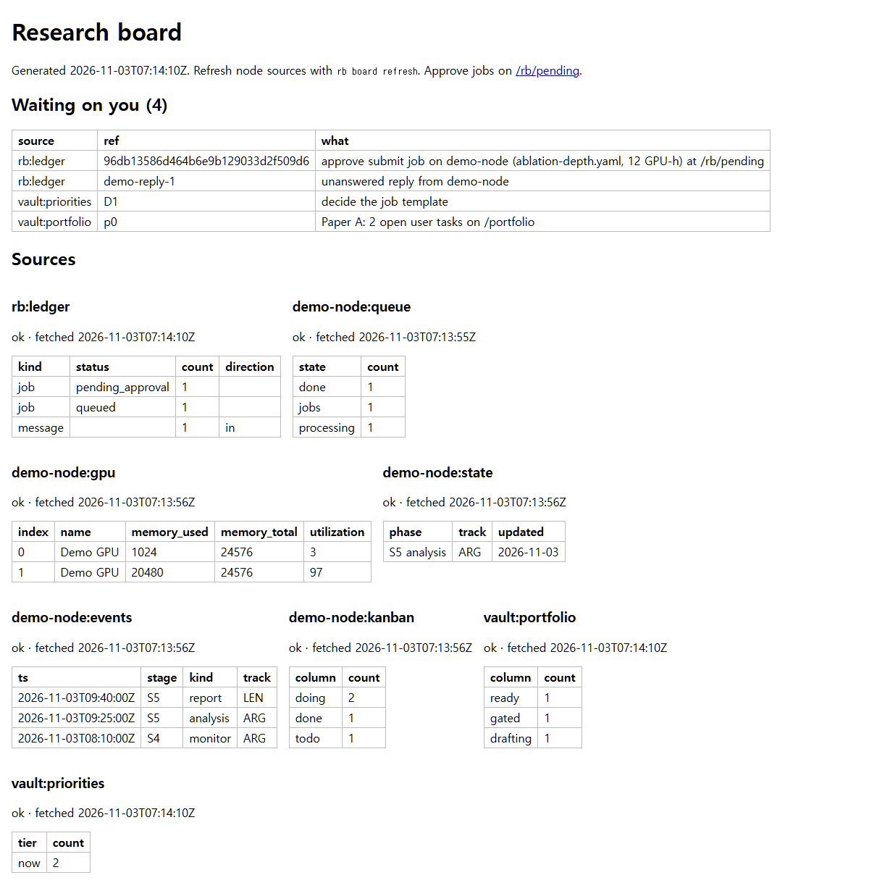
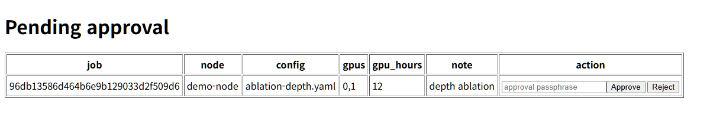

# research-bridge

Laptop-to-node bridge for Claude sessions: an MCP server (`rb-host-mcp`) and an approval CLI (`rb`).
The node side (`rb-node`) is stdlib-only and is reached over SSH.

## What it looks like

Screenshots from `scripts/demo_dashboard.py`. They show the two pages the 8765 dashboard serves, using made-up data: a throwaway local node, two jobs and fake GPUs. No real node, ledger or vault file is involved.

**Unified board** (`/board`). This page only shows data. The "waiting on you" list comes first, then one table per source:

- `rb:ledger`: the laptop ledger, read live;
- `<node>:queue|gpu|state|events|kanban`: the node, from the cache that `rb board refresh` writes;
- `vault:portfolio|priorities`: the vault files, read live.

**Pending approval** (`/rb/pending`). Each Approve button needs the approval passphrase, and the node itself checks it. A wrong passphrase gets "approval refused by the node" and the job stays pending. In the screenshot, the first demo job was approved with the right passphrase: it now shows as `queued` in the ledger and as a `jobs` entry in the node queue on the board above. Reject needs no passphrase and makes no node call.

Run the demo yourself. It needs the unified board (`rb_host/board.py`) and node-side approval (`rb_node/approval.py`):

    python scripts/demo_dashboard.py            # then open http://127.0.0.1:8799/board
                                                 # approval passphrase: demo passphrase

## Setup

All config files are written by two commands, `rb config` (laptop) and `rb-node config` (node
console). You do not need to edit JSON by hand. Step-by-step manuals for both roles, including
SSH keys and `authorized_keys`: `docs/manual/`.

### Config files and where they live

| File | Holds | Written by | In git? |
|---|---|---|---|
| `D:/raw/research-bridge/host.json` (or `$RB_HOST_CONFIG`) | nodes, their SSH aliases, data root, board paths | `rb config` | no: outside the checkout |
| `private/local.json` in the checkout | real laptop and node home paths (harness path mapping) | `rb config local` | no: `private/` is ignored |
| `~/.research-bridge/node.json` on the node (or `$RB_NODE_CONFIG`) | read/write roots, queue, `job_template`, `harness_root` | `rb-node config` | no: outside the checkout |
| `local.example.json`, `deploy/*.example` | placeholders only | by hand | yes |

Real host names, ports, user names and IPs never go into tracked files. Tracked files use
placeholders (`node1`, `<NODE_HOST>`, `<NODE_PORT>`, `<NODE_USER>`, `<LAPTOP_USER>`,
`<LAPTOP_ETH_SUBNET>`, ...); the mapping to real values is kept in the gitignored
`private/placeholders.md`.

How leaks are prevented:

- `.gitignore` covers `private/`, `host.json`, `node.json`, `local.json`, `*.local.json`, `.env*`
  and SSH key files (`*_ed25519*`, `id_rsa*`, `*.pem`, `*.key`). Templates keep an `.example`
  suffix so they stay tracked.
- Before writing, `rb config` and `rb-node config` ask git whether the target would be tracked
  (inside a work tree and not ignored, or already tracked). If so, the write is refused. Files
  are written with mode 600.
- `rb config check` reports `LEAK RISK` for an existing config file git would pick up.
- `rb config` only reads `~/.ssh/config` and `~/.claude.json`; it never writes them.
  `rb config mcp` prints the entry to add yourself.

### Laptop (hub)

    python -m venv .venv
    .venv/Scripts/python -m pip install -e ".[host]"

    rb config init                                   # host.json with no nodes
    rb config add-node node1                         # aliases rb-node1, rb-node1-harness
    rb config add-node node1 --alias A --harness-alias B --force   # other alias names
    rb config local --laptop-home C:/Users/<LAPTOP_USER> --node-home /home/<NODE_USER>
    rb config set nodes.node1.board.state <path>/STATE.md          # optional board paths
    rb config mcp                                    # prints the ~/.claude.json entry
    rb config check                                  # lists what is missing; exit 0 = ready
    rb config show                                   # prints host.json and local.json
    rb config path                                   # prints where they are

`rb config set` keys: `data_root`, `withheld_patterns_file`, `board.portfolio`,
`board.priorities`, `nodes.<n>.alias`, `nodes.<n>.harness_alias`,
`nodes.<n>.board.state|events|kanban`. `rb config check` also confirms that every alias is a
`Host` in `~/.ssh/config` and that the MCP server is registered. The MCP entry it prints runs
`<venv python> -m rb_host.server`.

### Node (run on the node console, not through the bridge)

    rb-node config init                              # ~/.research-bridge/node.json, defaults
    rb-node config set job_template '["uv", "run", "pretrain.py", "--config", "{config}"]'
    rb-node config set harness_root /home/<NODE_USER>/.claude
    rb-node config set read_roots '["lab/registry/", "lab/experiments/"]'
    rb-node config set withheld_source /path/to/withheld_patterns.json
    rb-node approve-key set                          # approval passphrase (verifier only)
    rb-node config check                             # lists what is missing; exit 0 = ready
    rb-node config show

List values take JSON. Unknown keys and wrong types are refused. The bridge key's forced
command (`rb-node serve-remote`) cannot reach `rb-node config`, so the hub cannot change node
paths.

## MCP tools

Tools: `nodes`, `send_message`, `poll`, `thread`, `read_doc`, `fetch_file`, `queue_status`,
`gpu_status`, `submit_job`, `cancel_job`. `submit_job` and `cancel_job` only write a
`pending_approval` record to the ledger; nothing reaches the node until you approve.

## rb CLI

    rb pending                 # list jobs waiting for approval
    rb approve <job_id>        # show the job, ask y/N and the approval passphrase, then upload config and submit/cancel
    rb approve --yes <job_id>  # skip the y/N question; the passphrase is always asked
    rb reject <job_id>         # mark rejected; no node call
    rb harness push --node N [--dry-run]   # laptop harness -> node harness-staging/<stamp>/
    rb harness pull --node N               # node harness -> D:/raw/research-bridge/harness-staging/<stamp>/
    rb harness diff <stamp>                # unified diff of a pulled stamp against ~/.claude

Approving the same job twice is a no-op.

## Harness channel (manual)

Separate SSH key and alias (`rb-<node>-harness`, or `harness_alias` in the host node entry) whose
forced command is `rb-node harness-receive`. It routes on `SSH_ORIGINAL_COMMAND`: `harness-send`
(node tars its allowlisted subset), empty or `harness-push` (stage a received tar). Set
`harness_root` (the node's `~/.claude`) in `node.json`; without it push and pull are refused
(`no_harness_root`). Allowlist: `CLAUDE.md`, `settings.json`, `rtk-reference.md`, `commands/`,
`agents/`, `hooks/`, `workflows/`. Tars are checked member by member (no absolute paths, `..`,
links or devices) before anything is written. `settings.json` and other `.json` files with a
populated credential-like key block the transfer.

There is no apply command. After reading `rb harness diff <stamp>`, copy by hand, for example:

    cp -r D:/raw/research-bridge/harness-staging/<stamp>/agents/. ~/.claude/agents/

(On the node, staged pushes sit in `~/.research-bridge/harness-staging/<stamp>/`; copy them into
`~/.claude` the same way.)
