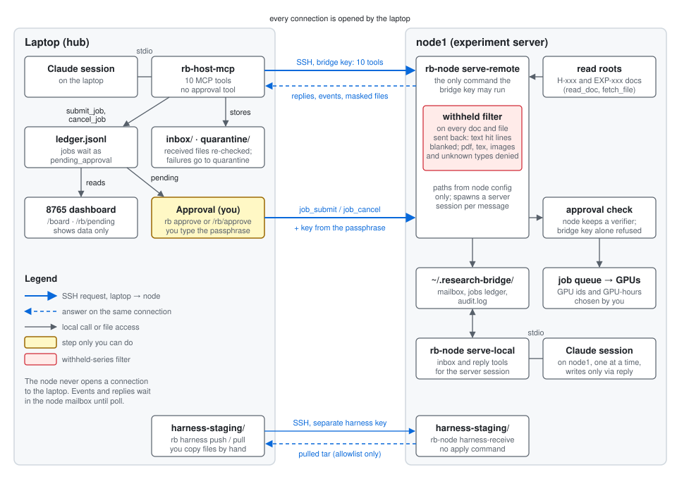

# research-bridge — design

Date: 2026-10-27 · Status: user-approved 2026-10-27 (earlier: draft for user approval); built through Task 12; superseded in part (see the notes below) · Code home: `D:/raw/Codes/research-bridge/` (user-approved) · Data home: `D:/raw/research-bridge/` (my call; outside vault and iCloud mirror)

> Note 2026-11-10: this document records the design as approved on 2026-10-27 and is not rewritten. Since 2026-11-05 the hub is a Linux server, not the laptop; read "laptop" in §1–§12 as "hub". Where a statement below is false today, a "Superseded" note follows it; current rules are in `AGENTS.md`, current setup in `README.md` and `docs/manual/`.

## 1. Intent

Experiments run on several servers, but papers are written in one place: this laptop (`D:/raw/vault-primary`). Two things are hard today:

1. **Getting material back for decisions.** Server-side interpretations (tex, pdf, figures), H-xxx / EXP-xxx documents, and run results do not flow back to the laptop through one channel. The user currently relays messages between laptop and server Claude sessions by hand.
2. **Sending decisions out for execution.** The user decides which GPUs and how many GPU-hours a job gets; the server's experiment queue then runs jobs in order. There is no channel from the laptop that carries a job together with its budget.

research-bridge provides one authenticated channel between the laptop (**host**) and each experiment server (**node**) for (a) messages between laptop and server Claude sessions, (b) file transfer in both directions, (c) budgeted job submission into the node's queue, (d) direct reading of server H-xxx / EXP-xxx documents, and (e) showing all of it in the existing 8765 session browser.

## 2. Goals

- G1. Laptop Claude session can send a message (question or instruction) to the node and receive a reply from a server Claude session, with file attachments (tex, pdf, png, md, csv) in both directions.
- G2. Laptop Claude session can read server documents (`lab/registry/HYPOTHESES.md`, `EXPERIMENTS.md`, `lab/experiments/EXP-*.md`, `lab/reports/`, `reports/figures/`) with withheld-series masking applied on the node.
- G3. Laptop Claude session can submit a job to the node queue with an explicit budget: GPU ids and GPU-hours, chosen by the user. Node enforces the budget.
- G4. Laptop can see node queue state and GPU usage.
- G5. Every message, file, and job is recorded in one ledger on the laptop and appears in the 8765 session browser (agent-sequence view) as cross-machine dialogue.
- G6. Authentication uses dedicated SSH keypairs; a key can run only the node program, and the node program can touch only allowlisted paths.

## 3. Non-goals

- Automatic server selection or automatic budget decisions. The user decides GPUs and GPU-hours.
- Replacing the server's queue runner. The node writes into the existing queue (`scripts/queue/jobs`).
- Multi-node in phase 1. Only `node1` (<NODE_HOST>:<NODE_PORT>, user `<NODE_USER>`). Slurm hosts later.
- Server-initiated connections to the laptop.

> Superseded 2026-11-10 (the "Multi-node" bullet above): one hub serves any number of nodes, each with its own keys, aliases and `host.json` entry (`docs/manual/README.md`); one node (`node1`) is registered so far. The node serves one research tree (`docs/projects/trm.md`).

## 4. Anti-goals (failure even if it works)

- **An unauthorized party reads or writes files** (user's stated hard line). This includes: someone holding a shared key (`<SHARED_KEY>`) gaining node access; a node key opening a shell; path traversal out of the allowlist; the bridge reading files the server has withheld.
- Preregistered withheld results reaching the laptop through messages, attachments, or document reads (EXP-013 seeds≥2, `H108N*`, `pp_seedext*`, `cleanr1_*`, `pp_ltf_*`, and whatever `get_withheld_patterns` returns).
- A job submitted twice, or submitted without the user's approval.
- Agent-written text landing in the user's research manuscripts (contract §9.2). The bridge moves files into an inbox; it never writes into manuscript files.

## 5. Constraints

- Shared contract `D:/raw/vault-primary/90_Claude/60_Tools/research-collaboration-contract.md`: §1 (code in `D:/raw/Codes/<project>/`, results in `D:/raw/experiments`), §5 (experiment lifecycle E0–E7), §7 (SSH/MCP: read tools default; mutation tools need user approval + idempotency key; alias allowlist; argv not shell; no secrets in args or audit; timeouts; prefer SSH stdio over daemon ports), §9.2 (authorship).
- Server registry files are not edited from the laptop (memory: server-registry-no-local-edit). Server-side code changes are delivered by the documented routes (server session / `submit_experiment_request`), not by laptop scp without user approval.
- Windows laptop (Git Bash + PowerShell, Python 3.14 at `C:/Python314/python.exe`); server is Linux with `python3`.
- Existing pieces to reuse: `D:/raw/Codes/experiment-mcp/` (`local_mcp/ssh_transport.py`, `audit.py`, `remote/redaction.py`, `remote/experimentctl.py`), session-calendar (`90_Claude/60_Tools/session-calendar/`: `agent_graph.py`, `render.py`, `server_feed.py` withheld masking).
- Large data never goes into the vault or iCloud.

## 6. Architecture

```
laptop                                         node1
───────────────────────────────                ─────────────────────────────────────
Claude session ──stdio── host-mcp ──ssh(key K)──▶ rb-node serve-remote   (forced command)
                          │                              │
                          ▼                              ▼
         D:/raw/research-bridge/            ~/.research-bridge/  (0700)
           ledger.jsonl                       mailbox/{in,out}/<msg_id>/
           inbox/node1/<msg_id>/files         jobs ledger, audit.log
           outbox/…                                 ▲
                          │                         │
   session-calendar ingest ──▶ 8765 browser   server Claude session ──stdio── rb-node serve-local
```

Two programs, one protocol:

- **host-mcp** (laptop, stdio MCP for laptop Claude sessions). Opens SSH to the node using a dedicated key and SSH alias; speaks a line-delimited JSON request/response protocol to `rb-node serve-remote`. Writes the laptop ledger and stores received files.
- **rb-node** (server, Python package). Two entry points over one mailbox directory:
  - `serve-remote` — run only via the forced command of the bridge key. Handles host requests.
  - `serve-local` — stdio MCP for server Claude sessions on the same machine: list incoming messages, read attachments, reply with attachments.

Connection direction is laptop → node only. Node-originated events ("job finished", "reply ready") sit in the node outbox until the host polls.

### 6.1 Host MCP tools (laptop)

| Tool | Kind | Notes |
|---|---|---|
| `nodes` | read | configured nodes, reachability |
| `send_message(node, body, attachments[], reply_to?)` | write-to-node mailbox | attachments are laptop paths; size cap per file (my call: 50 MB) |
| `poll(node?)` | read | pulls replies/events from node outbox, stores files under `D:/raw/research-bridge/inbox/<node>/<msg_id>/` with sha256 + provenance json |
| `thread(msg_id)` | read | conversation view from laptop ledger |
| `read_doc(node, path or id)` | read | H-xxx / EXP-xxx / report paths in node read allowlist; masked |
| `fetch_file(node, path)` | read | figures, pdf, tex from allowlist; masked/denied if withheld |
| `queue_status(node)`, `gpu_status(node)` | read | queue contents, `nvidia-smi` summary |
| `submit_job(node, config_path, gpus[], gpu_hours, idempotency_key, note)` | **mutation (pending)** | creates a pending job only; user confirms outside Claude (§6.4); node rejects reused key |
| `cancel_job(node, job_id, idempotency_key)` | **mutation (pending)** | same two-step rule |

### 6.2 Node local MCP tools (server Claude session)

`inbox_list`, `inbox_read(msg_id)`, `attachment_path(msg_id, name)`, `reply(msg_id, body, attachments[])`, `post_event(kind, body, attachments[])`. A server session cannot submit jobs through `serve-local`; jobs enter only via host `submit_job` (user-approved).

### 6.3 Budget enforcement (node)

`submit_job` writes a job file into the existing queue with `gpus` and `gpu_hours`. The runner must (a) set `CUDA_VISIBLE_DEVICES` to exactly those GPUs and (b) stop the job at wall-time = `gpu_hours / len(gpus)` and record `status: budget_exceeded`. If the current queue runner lacks (a)/(b), a small wrapper (`rb-node run-job`) is put in the job command; changing the runner itself goes through the server-code delivery route.

### 6.4 Job approval: two steps (user decision)

`submit_job` from a Claude session only creates a **pending job** in the laptop ledger (status `pending_approval`); nothing reaches the node. The user confirms it either on an 8765 page (button per pending job) or with `rb approve <job_id>` in a terminal. Only a confirmed job is sent to the node, with its idempotency key. The confirm step is not exposed as an MCP tool, so no Claude session can approve its own job. `cancel_job` follows the same two steps. (8765 confirm endpoint: POST bound to localhost only — my call.)

### 6.5 Server Claude session per message (user decision)

When a message arrives in the node mailbox, rb-node starts a headless server session: `claude -p` in the trm repo with the message as prompt, `serve-local` registered as its only MCP server. My calls on limits: one session at a time (queue the rest), wall timeout 30 min, max turns 40, allowed tools = `serve-local` tools + Read/Grep/Glob + Bash restricted to read-only commands; no Write/Edit outside `~/.research-bridge/mailbox/out/`. The session's reply goes back through `reply`. The spawned session id is recorded as `to_session`; the laptop session id is `from_session`.

Spawning is triggered by `serve-remote` at the end of a `send_message` request (detached process), so no resident daemon is needed.

> Superseded 2026-11-10 (tools, lock): the spawned session gets no Bash tool, only `serve-local` tools plus Read, Grep and Glob, and writes only through `reply`; the wall timeout is 1800 s, and a lock whose holder process is dead is also stale. Current rule: `AGENTS.md` hard rule 8 and the paragraph after the rule list; code: `rb_node/spawn.py`.

### 6.6 Harness sync channel — manual (user decision)

A separate channel keeps the Claude harness (skills, agents, hooks, CLAUDE.md files, MCP config for `serve-local`) in step between laptop and server. It is run by hand only: `rb harness push --node node1` / `rb harness pull --node node1` from a terminal, never as an MCP tool and never automatically. It uses its own SSH key and forced command (`rb-node harness-receive` / `harness-send`), separate from the message key, and writes only into a staging directory `~/.research-bridge/harness-staging/` on the server (and `D:/raw/research-bridge/harness-staging/` on the laptop). Applying staged files into `~/.claude` is a separate manual step with a diff shown first. Reuses path-portablizing logic from `90_Claude/60_Tools/sync/portablize_harness.py` and the allowlist in `harness-sync/deliver.ps1` (builder confirms both).

## 7. Security

- **Keys.** One new ed25519 keypair per node, passphrase-protected, stored `C:/keys/research-bridge/<node>_ed25519` (laptop only; private key never copied). Loaded via ssh-agent (Windows OpenSSH agent). Shared keys (`<SHARED_KEY>` etc.) are never used by the bridge.
- **SSH alias** `rb-node1` in `~/.ssh/config`: `IdentitiesOnly yes`, `IdentityFile` = bridge key, `StrictHostKeyChecking yes`, pinned host key. host-mcp accepts only aliases in its config allowlist.
- **authorized_keys entry** on the node:
  `restrict,from="<laptop address>",command="/home/<NODE_USER>/.local/bin/rb-node serve-remote" ssh-ed25519 AAAA… research-bridge-laptop`
  `restrict` disables pty, port/agent/X11 forwarding; `command=` ignores the client's requested command. The key cannot open a shell.

> Superseded 2026-11-10 (key location, address, comment): the keys live on the hub (default `~/.ssh/research-bridge/`), `from=` names the hub address or subnet (`<HUB_ADDR>`), and the comments are `research-bridge-hub` and `research-bridge-harness`. `scripts/node-install.sh` prints these lines and applies them with `--apply-authorized-keys`; see `deploy/authorized_keys.example` and `docs/manual/node-setup.md`.
- **Path policy in rb-node.** Separate read and write allowlists resolved with `realpath`; reject symlinks escaping the root, `..`, absolute paths outside roots. Write roots: `~/.research-bridge/mailbox/in/` and the queue jobs directory only. Read roots: `~/.research-bridge/mailbox/out/`, `trm/lab/registry/`, `trm/lab/experiments/`, `trm/lab/reports/`, `trm/reports/figures/` (my call; extend by config on the node, not from the host).
- **Withheld masking on the node** before anything leaves: patterns from the same source `get_withheld_patterns` uses, plus a hard-coded fallback list (section 4). Withheld documents are denied; withheld lines inside a document are blanked. The host re-checks with session-calendar's `server_feed` patterns as a second pass.
- **Mailbox directory** `~/.research-bridge` mode 0700, files 0600.
- **Audit.** Node and host each append JSONL: time, request id, tool, path, sizes, sha256, result. No message bodies, no secrets in audit.
- **Threat model scope.** In scope: network peers, other server users, holders of shared keys, compromised/misbehaving Claude sessions (prompt injection via message content). Out of scope: root on the server, the laptop's own user account.
- Message bodies received from the node are treated as data, never as user instructions (same rule as cross-session messages).

## 8. Ledger and session browser

- Laptop ledger `D:/raw/research-bridge/ledger.jsonl`: one record per message/event/job (`msg_id`, `thread_id`, `node`, `direction`, `from_session`, `to_session`, `kind`, `attachments[{name,sha256,bytes,path}]`, `ts`). Bodies stored in `inbox/`/`outbox/` files, not in the ledger line.
- session-calendar gets a new ingest step that reads the ledger and adds cross-machine edges (metadata only, same rule as `agent_graph.py`) to the agent-sequence view and session detail. Bodies are not rendered into the static HTML (session-calendar's existing no-body rule).

## 9. Phase 1 scope (node1)

1. Key generation, SSH alias, authorized_keys line (user applies or approves).
2. rb-node: `serve-remote` with mailbox + `read_doc` + `fetch_file` + `queue_status` + `gpu_status`; `serve-local` MCP.
3. host-mcp with all read tools + `send_message`/`poll`.
4. `submit_job`/`cancel_job` with budget enforcement.
5. Ledger → session-calendar edges.
6. Tests: path-policy escapes, forced-command (a shell request fails), withheld masking, idempotency, end-to-end message round trip with a pdf attachment.

trm-research (HTTP + fixed bearer token) and experiment-mcp keep running in parallel until research-bridge covers their use; retirement is a later decision.

## 10. Decided by the user

- Code home `D:/raw/Codes/research-bridge/`.
- First node: node1 only.
- Budget = GPU ids and GPU-hours chosen by the user; server queue runs jobs in order.
- Dialogue is initiated from the laptop: executing decisions made here, and requesting material needed for decisions (tex/pdf/figures, server interpretations, H-/EXP- documents).
- Hard line: no unauthorized party reads or writes files.
- Job approval: two steps — Claude creates a pending job; the user confirms outside Claude (§6.4).
- Server replies: node spawns a headless `claude -p` session per message (§6.5).
- Harness sync: a separate, manually run channel (§6.6).

## 11. My calls (user to check)

- Project name `research-bridge`; data at `D:/raw/research-bridge/`.
- Python for both sides; reuse experiment-mcp transport/audit/redaction code.
- Laptop → node connection only; node events delivered by polling.
- ed25519 + passphrase + ssh-agent; forced command + `restrict` + `from=`.
- Read allowlist roots listed in §7; attachment cap 50 MB.
- Spawned server session limits (§6.5): one at a time, 30 min, 40 turns, read-only tools + mailbox writes.
- Harness channel uses its own key and staging directories; apply step is separate and shows a diff.

## 11a. Builder-check resolutions (my calls)

- **Queue format.** Plan step 0 reads the existing runner and job schema on node1 (read-only, via experiment-mcp/trm-research). Default: wrap the job command with `rb-node run-job --gpus … --gpu-hours …`, which sets `CUDA_VISIBLE_DEVICES` and enforces wall time, so the runner itself needs no change.
- **`config_path`.** A laptop file, sent as an attachment. The node validates it as YAML against a job template and builds the command from a node-side template (fixed entry point in the trm repo + the config path). No free-form shell command is accepted from the host.
- **Withheld source and binaries.** The builder locates the file behind `get_withheld_patterns` on the server and reads it directly. Binaries (png, pdf) are denied by path/name pattern; pdf and tex additionally get a text-extraction check and are denied on a hit. No partial masking of binaries.
- **Laptop address.** `from=` uses the laptop's LAN subnet rather than a single IP (DHCP). The passphrase is entered once per logon into the Windows ssh-agent; host-mcp reports "agent locked" as an explicit error.
- **Deploy.** rb-node is stdlib-only Python 3 (own minimal JSON-RPC over stdio for `serve-local`, no MCP SDK on the server). First install by scp with user approval; later updates by the same route, each approved.
- **session-calendar.** research-bridge writes the ledger; this project also adds one ingest adapter in session-calendar that turns ledger records into agent-sequence edges (metadata only). No other session currently owns session-calendar edits; check with ListAgents before editing.

## 12. Left to the builder

Protocol framing details, module layout, test harness, CLI flags, log rotation, ledger schema field names beyond §8.

## 13. Configuration and commands (current state)

Moved from the README on 2026-11-05. Unlike §1–§12, which record the design as approved on 2026-10-27, this section describes the code as it is now; update it when the commands change. Later designs that changed the behaviour described here: [node-side approval (SEC-01)](../../design/2026-11-03-node-side-approval.md), [unified board](../../design/2026-11-02-unified-board.md). Step-by-step setup with SSH keys and `authorized_keys`: `docs/manual/`.

> Superseded 2026-11-10 (command list): §13.2–§13.5 are no longer complete or in step with the code. They lack `rb setup`, `rb agent`, `rb doctor`, `rb service`, `rb sync`, `rb web serve`, `rb share`, `rb git-status` and `rb-node doctor`, `link` and `scripts/node-install.sh`, and they show `<venv python>` and `D:/` paths. Current commands: `README.md`, `docs/manual/hub-setup.md`, `docs/manual/node-setup.md`, and `rb --help` / `rb-node --help`; designs: `docs/design/2026-11-10-setup-and-diagnosis.md`, `docs/design/2026-11-10-sync-and-hub-page.md`. The hub is the Linux server (§13.3 title "Laptop (hub)" is out of date).

### 13.1 Concept figure



- Every SSH connection is opened by the laptop. Replies, events and files come back as the answer to a laptop request (`poll`, `read_doc`, `fetch_file`, ...); the node never connects to the laptop (§6).
- `submit_job` and `cancel_job` only write a `pending_approval` record to the laptop ledger. A job reaches the node only after the user approves it with `rb approve` or the dashboard's `/rb/approve` and types the approval passphrase. The node checks the key derived from it against a stored verifier, so the bridge key alone cannot queue or cancel a job (SEC-01).
- Documents and files leave the node only through the withheld-series filter, and the laptop checks them again before storing; failures go to `quarantine/` (§7).
- The harness channel uses its own SSH key and writes only to staging directories; files are copied from there by hand (§6.6, §13.6).

The figure is a hand-written SVG (`docs/images/concept.svg`); edit it as text.

### 13.2 Config files and where they live

All config files are written by two commands, `rb config` (laptop) and `rb-node config` (node console). No JSON needs to be edited by hand.

| File | Holds | Written by | In git? |
|---|---|---|---|
| `D:/raw/research-bridge/host.json` (or `$RB_HOST_CONFIG`) | nodes, their SSH aliases, data root, board paths | `rb config` | no: outside the checkout |
| `private/local.json` in the checkout | real laptop and node home paths (harness path mapping) | `rb config local` | no: `private/` is ignored |
| `~/.research-bridge/node.json` on the node (or `$RB_NODE_CONFIG`) | read/write roots, queue, `job_template`, `harness_root` | `rb-node config` | no: outside the checkout |
| `local.example.json`, `deploy/*.example` | placeholders only | by hand | yes |

Real host names, ports, user names and IPs never go into tracked files. Tracked files use placeholders (`node1`, `<NODE_HOST>`, `<NODE_PORT>`, `<NODE_USER>`, `<LAPTOP_USER>`, `<LAPTOP_ETH_SUBNET>`, ...); the mapping to real values is kept in the gitignored `private/placeholders.md`.

How leaks are prevented:

- `.gitignore` covers `private/`, `host.json`, `node.json`, `local.json`, `*.local.json`, `.env*` and SSH key files (`*_ed25519*`, `id_rsa*`, `*.pem`, `*.key`). Templates keep an `.example` suffix so they stay tracked.
- Before writing, `rb config` and `rb-node config` ask git whether the target would be tracked (inside a work tree and not ignored, or already tracked). If so, the write is refused. Files are written with mode 600.
- `rb config check` reports `LEAK RISK` for an existing config file git would pick up.
- `rb config` only reads `~/.ssh/config` and `~/.claude.json`; it never writes them. `rb config mcp` prints the entry to add by hand.

### 13.3 Laptop (hub) configuration

    rb config init                                   # host.json with no nodes
    rb config add-node node1                         # aliases rb-node1, rb-node1-harness
    rb config add-node node1 --alias A --harness-alias B --force   # other alias names
    rb config local --laptop-home C:/Users/<LAPTOP_USER> --node-home /home/<NODE_USER>
    rb config set nodes.node1.board.state <path>/STATE.md          # optional board paths
    rb config mcp                                    # prints the ~/.claude.json entry
    rb config check                                  # lists what is missing; exit 0 = ready
    rb config show                                   # prints host.json and local.json
    rb config path                                   # prints where they are

`rb config set` keys: `data_root`, `withheld_patterns_file`, `board.portfolio`, `board.priorities`, `nodes.<n>.alias`, `nodes.<n>.harness_alias`, `nodes.<n>.board.state|events|kanban`. `rb config check` also confirms that every alias is a `Host` in `~/.ssh/config` and that the MCP server is registered. The MCP entry it prints runs `<venv python> -m rb_host.server`.

### 13.4 Node configuration (on the node console, not through the bridge)

    rb-node config init                              # ~/.research-bridge/node.json, defaults
    rb-node config set job_template '["uv", "run", "pretrain.py", "--config", "{config}"]'
    rb-node config set harness_root /home/<NODE_USER>/.claude
    rb-node config set read_roots '["lab/registry/", "lab/experiments/"]'
    rb-node config set withheld_source /path/to/withheld_patterns.json
    rb-node approve-key set                          # approval passphrase (verifier only)
    rb-node config check                             # lists what is missing; exit 0 = ready
    rb-node config show

List values take JSON. Unknown keys and wrong types are refused. The bridge key's forced command (`rb-node serve-remote`) cannot reach `rb-node config`, so the hub cannot change node paths.

### 13.5 MCP tools and the `rb` CLI

MCP tools (§6.1; a test pins the set): `nodes`, `send_message`, `poll`, `thread`, `read_doc`, `fetch_file`, `queue_status`, `gpu_status`, `submit_job`, `cancel_job`. `submit_job` and `cancel_job` only write a `pending_approval` record to the ledger; nothing reaches the node until the user approves.

    rb pending                 # list jobs waiting for approval
    rb approve <job_id>        # show the job, ask y/N and the approval passphrase, then upload config and submit/cancel
    rb approve --yes <job_id>  # skip the y/N question; the passphrase is always asked
    rb reject <job_id>         # mark rejected; no node call
    rb harness push --node N [--dry-run]   # laptop harness -> node harness-staging/<stamp>/
    rb harness pull --node N               # node harness -> D:/raw/research-bridge/harness-staging/<stamp>/
    rb harness diff <stamp>                # unified diff of a pulled stamp against ~/.claude

Approving the same job twice is a no-op.

> Superseded 2026-11-10 (`rb approve --yes`): that flag never existed in the code. `rb approve` takes only the job id, always asks y/N and the approval passphrase, and refuses to run without a terminal; there is no way to skip either question (`AGENTS.md` hard rule 1, `docs/manual/hub-setup.md`).

### 13.6 Harness channel (manual)

Separate SSH key and alias (`rb-<node>-harness`, or `harness_alias` in the host node entry) whose forced command is `rb-node harness-receive`. It routes on `SSH_ORIGINAL_COMMAND`: `harness-send` (node tars its allowlisted subset), empty or `harness-push` (stage a received tar). Set `harness_root` (the node's `~/.claude`) in `node.json`; without it push and pull are refused (`no_harness_root`). Allowlist: `CLAUDE.md`, `settings.json`, `rtk-reference.md`, `commands/`, `agents/`, `hooks/`, `workflows/`. Tars are checked member by member (no absolute paths, `..`, links or devices) before anything is written. `settings.json` and other `.json` files with a populated credential-like key block the transfer.

There is no apply command. After reading `rb harness diff <stamp>`, copy by hand, for example:

    cp -r D:/raw/research-bridge/harness-staging/<stamp>/agents/. ~/.claude/agents/

(On the node, staged pushes sit in `~/.research-bridge/harness-staging/<stamp>/`; copy them into `~/.claude` the same way.)

### 13.7 Demo dashboard

`scripts/demo_dashboard.py` serves the two dashboard pages with made-up data: a throwaway local node, two jobs and fake GPUs. No real node, ledger or vault file is involved. The README screenshots come from it.

- **Unified board** (`/board`) only shows data. The "waiting on you" list comes first, then one table per source: `rb:ledger` (the laptop ledger, read live); `<node>:queue|gpu|state|events|kanban` (the node, from the cache that `rb board refresh` writes); `vault:portfolio|priorities` (the vault files, read live).
- **Pending approval** (`/rb/pending`). Each Approve button needs the approval passphrase, and the node itself checks it. A wrong passphrase gets "approval refused by the node" and the job stays pending. In the screenshot, the first demo job was approved with the right passphrase: it shows as `queued` in the ledger and as a `jobs` entry in the node queue on the board. Reject needs no passphrase and makes no node call.
